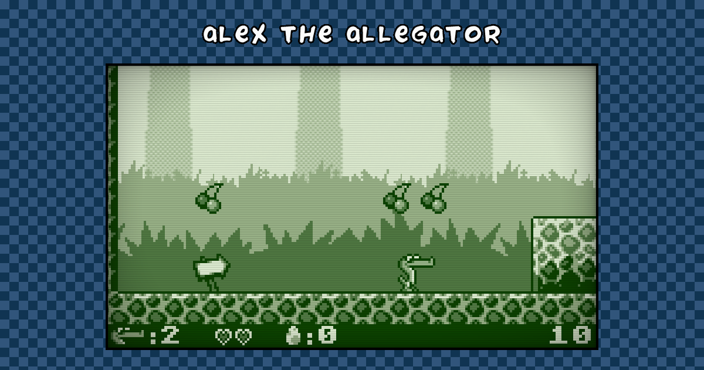

# Alex the Allegator 4 – Web Edition

An HTML5 remake of **Alex the Allegator 4**, the 2003 jump'n'run by Johan Peitz
of Free Lunch Design, made with the [melonJS](https://melonjs.org) game engine.

**[Play it in your browser](https://mixelstudio.github.io/Alex4-WE/)**

Lola has been captured by evil humans who want to make a bag of her. Guide Alex
through the jungle and save her! This edition has the whole game: all 12
levels, both guardians, the intro and the ending.

It is a modernized Alex 4 that stays true to the original: the same levels, the
same four-color graphics, music and rules, at the original's pace. What it adds
is game feel: Alex squashes as he lands, the action freezes for a split second
on every stomp and every blow to a guardian, the screen shakes on the big
impacts, pickups sparkle, dust flies, the ball leaves a trail, the jungle sways,
the water ripples and the screen breaks into big pixels between scenes.



## How to play

Every level has an exit that Alex must find. On the way, eat stars and cherries
for points, hearts for energy and eggs to spit at the enemies. Jump on an enemy
to knock it out, or step on a roll block to turn into a ball and smash through
ice blocks.

|          | Keyboard                    | Gamepad          |
| -------- | --------------------------- | ---------------- |
| Move     | <kbd>←</kbd> <kbd>→</kbd>   | stick or D-pad   |
| Jump     | <kbd>X</kbd>, <kbd>Space</kbd> or <kbd>↑</kbd> | <kbd>A</kbd> |
| Spit     | <kbd>Z</kbd>, <kbd>C</kbd> or <kbd>Enter</kbd> | <kbd>B</kbd> or <kbd>X</kbd> |
| Pause    | <kbd>P</kbd>                | <kbd>Start</kbd> |
| Menu     | <kbd>Esc</kbd>              | <kbd>Select</kbd> |

The menus also take a click or a tap, and so does the intro, to skip it.

Tip from the original manual: try to collect all the stars and cherries on
every level.

## History

- **2003** – Free Lunch Design releases Alex the Allegator 4, a four color
  game in the spirit of the Game Boy, and later its source code and data under
  the GPL.
- **2012** – Alex4 Web Edition: the first six levels remade in HTML5 with
  melonJS 0.9.
- **2026** – the Web Edition is rebuilt on melonJS 20 and completed from the
  original game's source and data: all 12 levels, as the original has them,
  the remaining enemies, both guardians, egg spitting, the intro and the
  ending. It plays with a keyboard, a gamepad or, in the menus, a mouse or a
  finger, and goes full screen.

## Running it

You need [Node.js](https://nodejs.org) 22 or later.

```sh
npm install
npm run dev       # play it at http://localhost:5173, reloading on changes
npm run build     # the game, ready to host, in dist/
npm run lint      # Biome
```

Add `#debug` to the address to show the melonJS debug panel.

Every push to `master` builds the game and publishes it to GitHub Pages (see
`.github/workflows/deploy.yml`).

## What's where

```
index.html          the page around the game
src/main.ts         starts the game, and the fullscreen button
src/game/           the game
  createGame.ts       the application, the screens, the Tiled object classes
  entities/           Alex, the enemies, the guardians, the pickups, the HUD
  screens/            title, intro, play, level complete, ending, credits
public/data/        sprites, tiles, fonts, music and sounds, Tiled maps
public/images/      the page's images
scripts/            how public/data/ is made from the original data
```

The levels are [Tiled](https://www.mapeditor.org) maps (`public/data/map/`) and
can be opened and edited in Tiled. The original game's bitmaps, maps and sounds
are converted by the Python scripts in `scripts/`; see
[scripts/README.md](scripts/README.md).

## Credits

**Original game**, © 2003 [Free Lunch Design](http://www.freelunchdesign.com/)

- Johan Peitz: design, code and graphics
- Anders Svensson: music and sound effects

The original game: <https://allegator.sourceforge.net>

**Web Edition**, 2012–2026

- Olivier Biot

**Game engine**

- [melonJS](https://melonjs.org), open source on
  [GitHub](https://github.com/melonjs/melonJS)

## License

Alex the Allegator 4 is © 2003 Johan Peitz, Free Lunch Design, and was released
under the GNU General Public License, version 2 or later. This Web Edition,
its code, its data and its scripts, is distributed under the same terms: see
[LICENSE](LICENSE).
